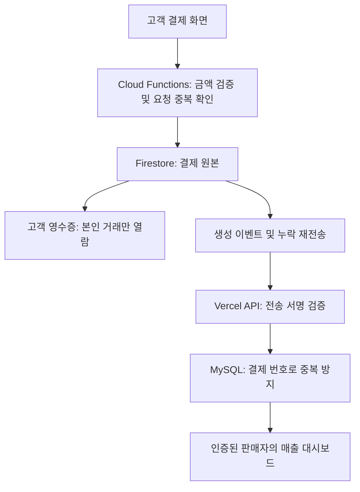

# 페이브릿지: Firestore + MySQL 모의 결제

고객의 결제 한 건을 Firestore에 원본으로 저장하고, 판매자용 MySQL에 복제하여 서로 다른 화면으로 보여주는 프로젝트입니다.

**현재 상태: 소스 작성 및 핵심 로직 단위 검사 완료. 전체 빌드·실제 DB 연동·배포는 미완료입니다. 배포 주소는 아직 없습니다.**

## 구성

| 구분 | 고객 | 판매자 |
|---|---|---|
| 화면 | 상품 선택, 모의 결제, 영수증 | 로그인, 매출 합계, 일별 차트, 거래 검색 |
| 프론트엔드 | React + Vite | Next.js App Router |
| 호스팅 대상 | Firebase Hosting | Vercel |
| 데이터베이스 | Cloud Firestore 원본 | 외부 MySQL 8 조회용 복제본 |
| 인증 | Firebase 익명 로그인 | Firebase 이메일/비밀번호 + 판매자 권한 |



## 핵심 파일

| 파일 | 역할 |
|---|---|
| [고객 화면](apps/customer/src/main.tsx) | 상품·수량 선택, 미확인 요청 복원, 모의 결제 동의, 영수증 구독 |
| [서버 함수](functions/src/index.ts) | 인증, 결제 생성, Firestore 트랜잭션, 자동 전송·재시도 |
| [공통 규칙](functions/src/domain.ts) | 입력 검증, 상품 가격, 결제 번호, 전송 서명 |
| [전송 처리](functions/src/delivery.ts) | HTTPS 전송, 15초 타임아웃, 실패 전파 |
| [동기화 API](apps/merchant/app/api/sync/payments/route.ts) | 원문 서명·시간 검증, 16KB 본문 제한, MySQL 저장 |
| [매출 API](apps/merchant/app/api/payments/route.ts) | 로그인 토큰 검증 후 해당 판매자의 자료 조회 |
| [MySQL 조회·저장](apps/merchant/lib/payments.ts) | 중복 삽입 방지, 내용 충돌 감지, 판매자 필터 |
| [판매자 화면](apps/merchant/app/page.tsx) | 로그인, 합계·그래프·거래 목록, 15초 자동 조회 |
| [DB 테이블](database/001-payments.sql) | 기본키, 판매자별 조회 인덱스, 원본 내용 해시 |
| [Firestore 규칙](firestore.rules) | 본인 영수증 단건 읽기만 허용, 브라우저 직접 쓰기 금지 |

## 실행 준비

Node.js 22와 npm이 필요합니다. 명령은 프로젝트 최상위 폴더에서 실행합니다. Windows PowerShell에서 npm 실행 정책 오류가 나면 `npm` 대신 `npm.cmd`를 사용하세요.

```powershell
npm install
Copy-Item apps/customer/.env.example apps/customer/.env.local
Copy-Item apps/merchant/.env.local.example apps/merchant/.env.local
Copy-Item functions/.env.example functions/.env
```

각 파일의 빈 값을 실제 프로젝트 값으로 채웁니다. 비밀번호와 비공개 키는 커밋하지 않습니다. 환경 변수 예제에는 실제 비밀값을 넣지 않았습니다.

```powershell
npm test
npm run build
npm run dev:customer
# 별도 터미널
npm run dev:merchant
```

고객 개발 주소는 Vite가 출력하는 주소, 판매자 개발 주소는 Next.js가 출력하는 주소를 사용합니다. Firebase 웹 설정이 없으면 화면은 연결 대기 상태를 표시하고 결제·로그인을 차단합니다. 가짜 성공 데이터를 표시하지 않습니다.

## 구현 정책

- 결제 금액은 서버 상품 목록에서 다시 계산합니다. 고객이 보낸 금액은 받지 않습니다.
- 같은 고객의 `requestId`는 같은 `paymentId`로 연결됩니다. 같은 요청 번호로 상품이나 수량을 바꾸면 거부합니다.
- 모의 결제 상태는 `MOCK_APPROVED`이며 실제 카드 승인을 의미하지 않습니다.
- 결제 원본 필드는 생성 후 수정하지 않습니다. 이번 버전에는 환불·취소·양방향 동기화가 없습니다.
- 이벤트 중복은 MySQL 기본키와 내용 해시로 처리합니다. 같은 번호에 다른 내용이 오면 409 오류를 반환합니다.
- 서버 간 전송에는 HMAC-SHA256(공유 비밀키로 만든 위변조 확인값)과 5분 유효 시간을 사용합니다.
- 동기화가 실패하면 원본은 남기고 오류를 기록한 뒤 함수 재시도를 요청합니다. 15분 주기 작업도 미전송 자료를 최대 100건씩 재전송합니다.
- MySQL 접속에는 TLS(암호화 통신)를 사용합니다. 인증서 검증을 끄지 않습니다. 로컬 개발용 localhost에서만 TLS를 끌 수 있습니다.
- 판매자 식별값은 검증된 로그인 토큰의 `merchant_id`에서 가져옵니다. URL이나 브라우저가 지정하는 판매자 번호는 사용하지 않습니다.
- 누적 합계는 전체 기간, 차트는 최근 30일, 목록은 최근 100건입니다. 일별 표시 시간은 한국 시간입니다.

## 배포

[배포 절차](docs/DEPLOYMENT.md)를 따르세요. [실제 검사 결과](docs/VALIDATION.md)에서 아직 확인하지 못한 항목을 확인할 수 있습니다.

첫 공개 배포 전에 `npm install`로 잠금 파일을 생성하고 정상 빌드·통합 시험을 마쳐야 합니다. 현재 환경에서는 npm 저장소 이름 조회가 실패해 잠금 파일과 전체 빌드 결과를 만들지 못했습니다.

## 공식 문서

- [Firestore 이벤트 전달과 중복](https://firebase.google.com/docs/functions/firestore-events)
- [Firebase 함수 배포와 Blaze 요구 사항](https://firebase.google.com/docs/functions/get-started)
- [Vercel MySQL 연결 풀 관리](https://vercel.com/kb/guide/connection-pooling-with-functions)
- [Next.js 2026-10-14 보안 업데이트](https://nextjs.org/blog/nextjs-security-update-october-14-2026) — 이 프로젝트는 15.5.28 이상을 요구합니다.
