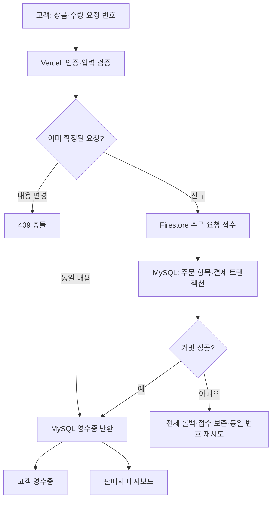
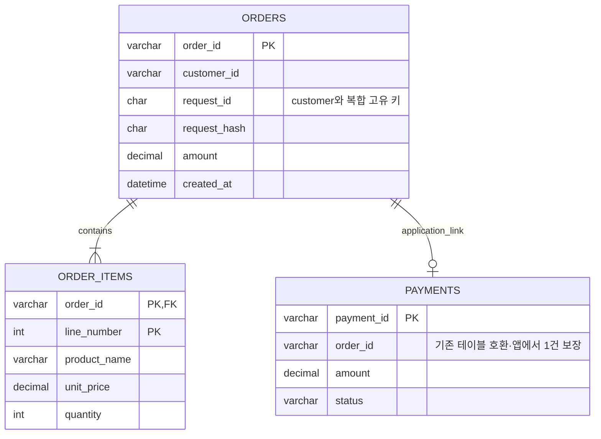

# Paybridge 구현 결과 보고서

## 핵심 한 줄

Firestore는 주문 요청을 접수하고, MySQL은 주문·항목·모의 결제를 함께 확정하며 고객과 판매자는 API로 같은 결제 원본을 조회합니다.

## 쉽게 보는 진행 과정 3줄

1. 고객 요청을 인증하고 금액은 서버 상품 가격으로 다시 계산합니다.
2. 요청을 Firestore에 남긴 뒤 MySQL 트랜잭션으로 주문·항목·결제를 함께 확정합니다.
3. 고객은 영수증으로, 판매자는 매출 그래프와 거래 목록으로 같은 MySQL 결제를 확인합니다.

## 확인 상태

Firebase Hosting·Firestore 보안 규칙·기본 Auth 배포 완료. Vercel 인증 수정본 2c5a5ac는 Production Ready로 확인했습니다. 단위 17건, Firestore 보안 통합 1건, 실제 MySQL 통합 1건, 운영 API 확인 12개 항목을 통과했습니다. 고객 화면의 24,000원 모의 결제 및 새로고침 후 영수증 복원을 확인했습니다. 판매자 실제 로그인·차트 시연은 권한 계정 준비 후 별도 확인해야 합니다.

고객: https://paybridge-mock.web.app / 판매자: https://paybridge-mock.vercel.app

## DB 관리 기준

| 저장소 | 책임 | 최종 기준 |
|---|---|---|
| Firestore order_requests | 본인 주문 요청 원문, 변경 불가 | 접수 사실만 담당 |
| MySQL orders | 고객·판매자·요청 고유 키·확정 주문 | 주문 확정 원본 |
| MySQL order_items | 주문 상품명·단가·수량 스냅샷 | 확정 시점 상품 정보 |
| MySQL payments | 확정된 모의 결제 | 영수증·매출의 공통 원본 |

결제 복제와 Cloud Functions는 사용하지 않습니다. 기존 Functions 소스는 과거 참고용이며 firebase.json 배포 대상에서 제외했습니다. 기존 동기화 API는 410을 반환합니다. MySQL payments의 기존 열은 호환을 위해 유지합니다. order_items에는 실제 FK가 있고 payments의 주문 관계는 앱 트랜잭션에서 보장합니다. 기존 데이터는 삭제하지 않는 추가 마이그레이션입니다.

## 처리 흐름

## 테이블 관계

## 소스 위치

| 기능 | GitHub 소스 | 처리 설명 |
|---|---|---|
| 고객 주문 요청 | [apps/customer/src/main.tsx](https://github.com/wevolmina/paybridge-mock/blob/main/apps/customer/src/main.tsx#L41) | 상품·수량·requestId만 전송하며, 응답을 잃어도 같은 번호로 재시도합니다. |
| 주문 확정 API | [apps/merchant/app/api/checkout/route.ts](https://github.com/wevolmina/paybridge-mock/blob/main/apps/merchant/app/api/checkout/route.ts#L9) | 인증·입력 검증 → 기존 확정 조회 → Firestore 접수 → MySQL 확정 순서입니다. |
| 인증과 판매자 권한 | [apps/merchant/lib/admin.ts](https://github.com/wevolmina/paybridge-mock/blob/main/apps/merchant/lib/admin.ts#L14) | 서명 검증 및 계정 온라인 조회로 만료·폐기·비활성 계정을 차단합니다. 판매자는 merchant_id 클레임을 사용합니다. |
| Firestore 주문 접수 | [apps/merchant/lib/checkout.ts](https://github.com/wevolmina/paybridge-mock/blob/main/apps/merchant/lib/checkout.ts#L35) | 고객 ID 토큰으로 REST API를 호출합니다. 요청 원문만 저장하며 금액이나 결제 승인 상태를 저장하지 않습니다. |
| MySQL 원자적 확정 | [apps/merchant/lib/checkout.ts](https://github.com/wevolmina/paybridge-mock/blob/main/apps/merchant/lib/checkout.ts#L20) | orders·order_items·payments를 한 연결의 트랜잭션으로 확정합니다. 오류면 모두 롤백합니다. |
| 주문 테이블·고유 키 | [database/002-orders.sql](https://github.com/wevolmina/paybridge-mock/blob/main/database/002-orders.sql#L1) | customer_id/request_id 고유 키로 동시 재시도를 직렬화합니다. 항목은 주문 외래 키와 상품명·단가 스냅샷을 보관합니다. |
| 고객 영수증 API | [apps/merchant/app/api/receipt/route.ts](https://github.com/wevolmina/paybridge-mock/blob/main/apps/merchant/app/api/receipt/route.ts#L8) | 로그인 고객 ID로 MySQL 결제 원본을 조회합니다. 다른 고객의 결제는 반환하지 않습니다. |
| 판매자 매출 조회 | [apps/merchant/lib/payments.ts](https://github.com/wevolmina/paybridge-mock/blob/main/apps/merchant/lib/payments.ts#L21) | 같은 payments 원본을 판매자 ID로 필터링합니다. 화면은 보이는 동안 5초 간격으로 조회합니다. |
| 주문 접수 보안 규칙 | [firestore.rules](https://github.com/wevolmina/paybridge-mock/blob/main/firestore.rules#L4) | 본인 요청 생성·단건 읽기만 허용합니다. 필드·상품·수량을 제한하고 변경·삭제·목록과 결제 문서 접근은 차단합니다. |
| 암호화 DB 연결 | [apps/merchant/lib/mysql.ts](https://github.com/wevolmina/paybridge-mock/blob/main/apps/merchant/lib/mysql.ts#L4) | TLS 인증서를 검증하며 작은 연결 풀을 재사용합니다. DB 비밀 값은 서버 환경 변수에만 둡니다. |

[왼쪽 소스·오른쪽 클릭형 흐름도](IMPLEMENTATION-REPORT.html)는 HTML 파일을 내려받아 브라우저에서 열면 동작합니다. GitHub Markdown에서는 위 소스 링크로 해당 파일의 함수 위치를 확인할 수 있습니다.

## 실패·재시도 원칙

- Firestore 접수 실패: 신규 MySQL 확정을 시작하지 않습니다.
- MySQL 확정 실패: 주문·항목·결제 모두 롤백하고 Firestore 요청은 남깁니다.
- 커밋 뒤 응답 유실: 같은 요청 번호로 기존 MySQL 결과를 먼저 조회해 반환합니다.
- 같은 번호에 다른 상품·수량: 409로 거절합니다. 동시 요청은 DB 고유 키와 행 잠금으로 직렬화합니다.
- 자동 재처리 큐는 없습니다. 고객의 동일 요청 재시도가 복구 방법입니다. 무인 재처리가 필요하면 별도 작업 큐가 필요합니다.

## 보안·운영

API는 Firebase 서명을 검증하고 accounts:lookup으로 계정 상태를 확인합니다. 익명 계정은 validSince가 생략될 수 있으므로 값이 있을 때만 폐기 시각을 비교하고, 잘못된 값은 거절합니다. 실제 폐기 토큰은 온라인 조회에서 TOKEN_EXPIRED로 차단됨을 확인했습니다. Firestore REST에는 고객 토큰을 전달하므로 보안 규칙이 적용됩니다. 고객은 자기 요청을 직접 생성할 수도 있지만 결제 금액·승인 상태는 만들 수 없습니다. API가 상품·수량과 신원을 별도로 검증한 후 MySQL만 확정합니다. CORS는 고객 호스팅 두 주소에만 허용하고, 모든 응답은 캐시하지 않습니다. 판매자 ID를 요청 본문에서 받지 않습니다.

Firebase Spark, 외부 무료 MySQL, Vercel Hobby 범위의 개인 모의 결제입니다. 무료 한도 초과 시 서비스 제한이 생길 수 있으며 실제 카드 승인은 지원하지 않습니다. 익명 사용자가 브라우저 데이터를 삭제하면 기존 영수증의 인증 신원을 복구할 수 없습니다. 공개 서비스 전에는 계정 로그인, 요청 속도 제한, 모니터링, 백업·복구 훈련을 추가해야 합니다.

I've set up prototype Security Rules to keep the data in Firestore safe. They are designed to be secure for owner-only immutable order intake with strict field validation and no payment writes. However, you should review and verify them before broadly sharing your app. If you'd like, I can help you harden these rules.

## 검증 방법

운영 검증 스크립트: [smoke-live.mjs](https://github.com/wevolmina/paybridge-mock/blob/main/scripts/smoke-live.mjs). 실행하면 익명 사용자와 모의 거래를 생성하므로 필요할 때만 실행합니다. 이번 운영 검증에서는 API 거래 12,000원과 브라우저 거래 24,000원, 모의 결제 2건을 남겼습니다.

`npm test` / 격리된 `_test` DB에서 `RUN_MYSQL_INTEGRATION=true npx tsx --test tests/integration/checkout.test.ts` / Firestore Emulator의 `firestore-rules.test.ts` / `npm run build`를 사용합니다. 신규 테스트는 동시 재시도, 요청 충돌, 고객 분리, 결제 INSERT 중 오류의 전체 롤백, 요청 스키마와 변경 금지를 확인합니다.

## 배포 방법

1. 서버 환경 변수에 기존 MYSQL_*와 FIREBASE_PROJECT_ID, 공개 Firebase 설정을 등록합니다. 서비스 계정 비밀 키 없이 ID 토큰 서명 및 온라인 계정 조회를 수행합니다.
2. TLS로 MySQL에 연결하여 `npm run db:migrate`를 실행합니다. 001과 002 테이블은 기존 데이터를 보존합니다.
3. `npm run build` 후 `npm run deploy:firebase`로 Hosting·Firestore·Auth만 배포하고 GitHub main 변경으로 Vercel을 배포합니다.
4. 판매자 이메일 계정을 만든 후 관리 권한으로 `merchant_id=studio-mina` 커스텀 클레임을 부여합니다. 공개 회원가입으로 판매자 권한을 얻을 수 없습니다.
