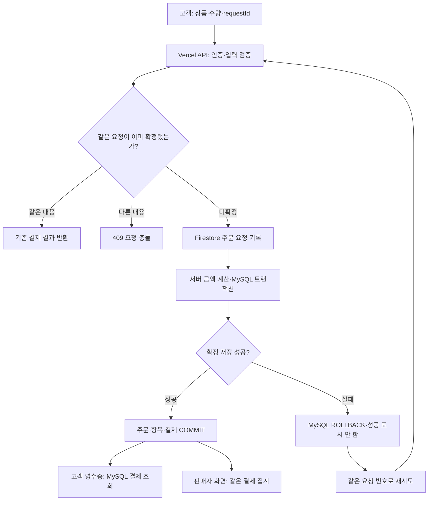
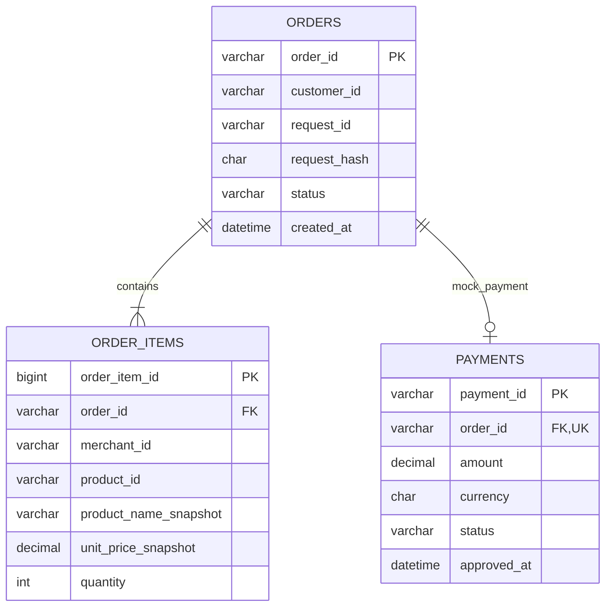
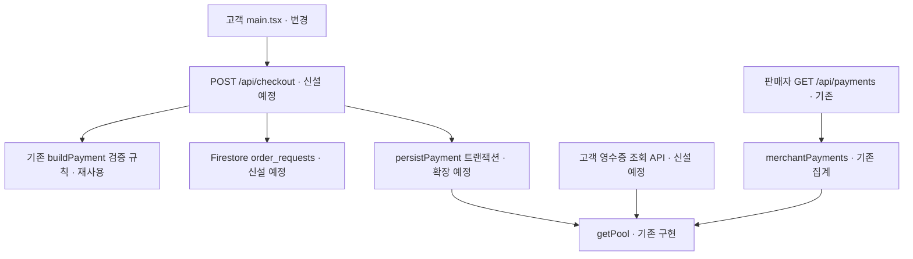

# Paybridge 설계 변경 및 구현 현황 보고서

## 핵심 한 줄

Firestore는 주문 요청을 보관하고 MySQL은 확정 주문·결제의 원본을 관리하며, 고객과 판매자는 API로 같은 MySQL 결제 데이터를 조회하는 구조로 설계를 변경했습니다.

## 진행 과정 세 줄

1. 일반적인 서비스처럼 MySQL의 주문·주문 항목·결제를 관계형 테이블로 나누고, 함께 확정할 데이터는 하나의 트랜잭션으로 처리하도록 정했습니다.
2. Firestore에는 고객이 제출한 주문 요청만 보관하고, 결제 데이터 복제와 Cloud Functions 기반 동기화는 새 설계에서 제외했습니다.
3. 기존 코드·배포·시험 결과를 새 설계와 대조했습니다. 이번 수정은 보고서이며, API 전환·테이블 추가·새 구조의 전체 연결 시험은 아직 구현 전입니다.

## 보고서 범위와 읽는 방법

| 항목 | 설명 |
|---|---|
| 이번 변경 | 일반적인 관계형 DB 관리 + Firestore 주문 요청 + MySQL 확정 결제 기준으로 보고서 수정 |
| 현재 코드 | 기존 Firestore 결제 원본 → MySQL 복제 방식이 아직 남아 있음 |
| 새 구조 상태 | 설계 확정. 이 보고서 수정만으로 API·DB·배포가 전환된 것은 아님 |
| 클릭형 보기 | [HTML 보고서](./IMPLEMENTATION-REPORT.html)를 내려받아 브라우저로 열기. 오른쪽 노드를 누르면 왼쪽 설명·현재 참고 코드·GitHub 링크 표시 |
| 소스 링크 | 실제 존재하는 파일의 함수 위치로 이동. 아직 없는 API와 테이블에는 구현 완료 링크를 만들지 않음 |

## 일반적인 DB 관리 원칙을 이번 프로젝트에 적용

**결제 원본은 MySQL 한곳에서 관리합니다.** 고객 화면과 판매자 화면이 서로 다른 DB의 결제 복제본을 읽지 않고, 서버 API(Application Programming Interface, 프로그램의 요청·응답 창구)를 통해 같은 MySQL 결제를 읽습니다.

| 관리 원칙 | 이번 프로젝트 적용 |
|---|---|
| 업무별 테이블 분리 | MySQL orders·order_items·payments로 구분 |
| 데이터 연결 | 주문 번호의 외래키로 주문 항목과 결제 연결 |
| 함께 확정할 작업 묶기 | 주문 확정·항목 저장·모의 결제 저장을 같은 MySQL 연결의 트랜잭션으로 처리 |
| 원본 기준 통일 | 결제 성공·결제 금액·매출·영수증의 최종 기준은 MySQL |
| 접근 제한 | 브라우저의 DB 직접 쓰기를 막고 서버에서 고객·판매자 권한 확인 |
| 변경·운영 관리 | 번호를 붙인 DB 변경 스크립트, 시험 DB 검증, 백업·복원 확인. 운영 테이블을 임의로 삭제하지 않음 |

일반 서비스의 users·merchants·products도 규모가 커지면 별도 테이블로 관리할 수 있습니다. 이번 최소 전환에서는 회원 신원은 Firebase Authentication, 상품 가격은 기존 서버 상품표를 사용하고, 확정 주문·항목·결제를 먼저 정리합니다. 모든 참고 테이블을 이미 만들었다는 의미는 아닙니다.

## 두 DB의 역할과 원본 기준

| 구분 | Firestore | MySQL |
|---|---|---|
| 역할 | 고객이 제출한 요청의 접수 기록 | 확정 주문·결제·매출의 업무 원본 |
| 구조 | order_requests 문서: 신설 예정 | orders·order_items 신설, payments 변경 예정 |
| 주요 값 | requestId, customerId, productId, quantity, receivedAt, 요청 내용 해시 | 주문 번호, 요청 고유키, 구매 당시 상품·가격, 결제 번호·금액·상태 |
| 성공 판단 | 문서가 있다는 것은 요청이 접수됐다는 뜻 | COMMIT된 MOCK_APPROVED 결제가 성공 기준 |
| 고객 화면 | 주문 요청 접수 여부가 필요할 때 참고 | 확정 결제의 영수증을 API로 조회 |
| 판매자 화면 | 매출을 집계하지 않음 | 같은 확정 결제로 합계·차트·거래 목록 표시 |

Firestore에는 확정 결제의 전체 복제본을 만들지 않습니다. 요청의 상품·수량처럼 일부 값이 MySQL 주문 항목과 겹칠 수는 있지만, 역할은 **접수 기록과 확정 업무 기록**으로 다릅니다. Firestore에 별도의 결제 성공 상태를 유지해 원본을 둘로 만들지 않고, 진행 결과는 API에서 MySQL을 확인합니다.

두 DB 사이에는 외래키가 없습니다. requestId와 customerId는 논리적인 연결 기준이며, 사용자 식별자는 서버가 인증 결과에서 결정합니다.

## 변경 전과 변경 후

| 항목 | 현재 구현된 이전 방식 | 확정한 새 설계 |
|---|---|---|
| 결제 원본 | Firestore payments | MySQL payments |
| Firestore 역할 | 결제 저장·영수증 구독 | 주문 요청 접수 기록 |
| MySQL 역할 | 판매자 조회용 결제 복제본 | 확정 주문·결제 원본 |
| 서버 처리 | Cloud Functions → 서명 API → 복제 | Vercel API가 검증·요청 기록·결제 확정 |
| 고객 영수증 | Firestore onSnapshot | 결제 API 응답·본인 결제 조회 API |
| 판매자 매출 | 복제된 MySQL 결제 조회 | 같은 원본 MySQL 결제 조회 |
| 정기 복제 | 이벤트 재전송·15분 보완 작업 | 결제 복제 작업 없음 |
| Firebase 요금제 | Functions 배포에는 Blaze 필요 | Functions를 쓰지 않는 Spark 구성 목표 |

기본 Firebase 인증과 Firestore·Hosting은 무료 할당량 범위에서 사용하고, Vercel Hobby와 Aiven 무료 MySQL을 활용하는 개인 모의 결제 구성입니다. 무제한 사용이나 실제 상업 서비스의 무료 운영을 보장하지 않습니다. Blaze 연결과 Identity Platform 업그레이드는 새 설계의 전제 조건이 아닙니다. 서버 인증 설정은 별도로 준비해야 합니다.

## 목표 결제 흐름도

다음은 **변경할 설계**이며 현재 배포된 동작의 증명은 아닙니다.

Firestore 요청 기록이 실패하면 새 결제 확정을 시작하지 않습니다. 이미 확정된 동일 요청의 재시도라면 서버가 MySQL의 기존 결과를 먼저 찾아 반환할 수 있습니다. 동시 요청에 대한 최종 중복 방지는 API의 사전 조회만으로 처리하지 않고 MySQL 고유 제약으로 보장해야 합니다.

## MySQL 테이블 관계도

아래 필드는 설계 예시입니다. 현재 운영 DB에는 기존 payments만 생성되어 있습니다.

- orders에 `(customer_id, request_id)` 복합 UNIQUE(고유 제약)를 둡니다. 같은 요청 번호에 다른 상품·수량이 들어오면 요청 내용 해시를 비교해 409로 거부합니다.
- order_items에는 구매 당시 상품명과 단가를 보관해 나중에 상품 가격이 바뀌어도 과거 영수증 금액이 바뀌지 않게 합니다.
- payments.order_id의 UNIQUE는 이번 모의 결제에서 주문당 확정 결제 1건이라는 범위입니다. 실제 결제의 여러 승인 시도·부분 취소는 별도 결제 시도·취소 이력 모델이 필요합니다.
- MySQL 외래키와 고유 제약은 주문·항목·결제 사이에 적용합니다. Firebase 사용자와 Firestore 요청 문서까지 물리적인 외래키로 묶지는 않습니다.

## 트랜잭션과 실패 처리

트랜잭션은 **여러 DB 작업을 전부 성공시키거나 전부 취소하는 묶음**입니다. 이번 트랜잭션의 범위는 MySQL 내부입니다. Firestore 접수 기록과 MySQL 결제를 하나의 일반적인 MySQL 트랜잭션으로 묶지 않습니다.

| 실패 지점 | 남는 데이터 | 사용자 안내·복구 기준 |
|---|---|---|
| 인증·입력 검증 실패 | 새 결제 없음 | 로그인·입력 오류 안내 |
| Firestore 접수 기록 실패 | 새 확정 결제 없음 | 결제 성공 표시 없이 같은 요청 번호로 재시도 |
| 접수 후 MySQL 저장 실패 | Firestore 주문 요청은 남음 | MySQL 트랜잭션은 ROLLBACK. 접수와 결제 성공을 구분 |
| MySQL COMMIT 후 응답 유실 | 확정 주문·결제 존재 | 같은 요청 번호로 기존 결제 조회. 새 결제 생성 안 함 |
| 같은 요청이 동시에 도착 | 고유 제약으로 확정 1건 | 기존 거래 반환 또는 내용 충돌 거부 |
| 판매자 조회 실패 | 확정 결제는 유지 | 오래된 숫자를 최신 성공 결과로 오인시키지 않고 오류·재시도 안내 |

접수됐지만 미확정인 요청이 자동으로 성공하는 것은 아닙니다. 고객의 재시도·상태 조회 기능을 구현하고, 오래 남은 미확정 요청을 확인하는 운영 기준도 정해야 합니다. 기존 Cloud Functions의 자동 복구가 새 구조에서도 그대로 작동한다고 표현하지 않습니다.

## 실시간 표시 범위

고객 영수증은 COMMIT 후 결제 API 응답으로 표시합니다. 판매자 화면은 API를 호출해야 새 거래를 알 수 있습니다. 처음에는 화면을 보고 있을 때 5초 간격 자동 조회를 목표로 하고, 숨겨진 탭에서는 멈추도록 설계합니다. 현재 코드는 15초 조회이며 아직 변경되지 않았습니다. API 사용 자체가 무지연 실시간 갱신을 뜻하지는 않습니다.

## 현재 소스와 변경할 위치

| 단계 | 현재 소스 위치 | 상태 | 새 설계에서 할 일과 현재 코드의 차이 |
|---|---|---|---|
| 01 고객이 주문 요청 전송 | [apps/customer/src/main.tsx](https://github.com/wevolmina/paybridge-mock/blob/main/apps/customer/src/main.tsx#L33) | 변경 필요 | 상품·수량·requestId를 Vercel API로 보냅니다. 현재 코드는 Firebase callable createPayment를 호출하므로 요청 경로를 바꿔야 합니다. |
| 02 Vercel 서버가 검증·처리 | [functions/src/domain.ts](https://github.com/wevolmina/paybridge-mock/blob/main/functions/src/domain.ts#L30) | 기존 규칙 재사용·새 API 필요 | 로그인 신원과 상품·수량을 확인하고 서버 가격으로 계산합니다. POST /api/checkout은 새로 만들 예정이며, 아래는 재사용할 기존 계산 코드입니다. |
| 03 Firestore에 주문 요청 기록 | [functions/src/index.ts](https://github.com/wevolmina/paybridge-mock/blob/main/functions/src/index.ts#L17) | 변경 필요 | order_requests에 요청자·상품·수량·요청 시각을 저장합니다. 아래 기존 코드는 payments 원본을 만드는 이전 방식이며, 새 요청 저장 코드가 아닙니다. |
| 04 MySQL에서 주문·결제를 함께 확정 | [apps/merchant/lib/payments.ts](https://github.com/wevolmina/paybridge-mock/blob/main/apps/merchant/lib/payments.ts#L7) | 트랜잭션 확장 필요 | orders·order_items·payments를 같은 연결의 트랜잭션으로 저장합니다. 기존 함수는 payments만 저장합니다. 새 설계에서는 requestId 중복 검사와 확정 주문 저장까지 확장해야 합니다. |
| 저장소 MySQL 관계형 테이블 구성 | [database/001-payments.sql](https://github.com/wevolmina/paybridge-mock/blob/main/database/001-payments.sql#L1) | 테이블 추가 필요 | 현재 생성된 테이블은 payments 하나입니다. orders·order_items와 요청 고유키·외래키를 추가하는 것은 앞으로의 변경이며 아래 SQL에는 아직 없습니다. |
| 05 MySQL 결제로 고객 영수증 표시 | [apps/customer/src/main.tsx](https://github.com/wevolmina/paybridge-mock/blob/main/apps/customer/src/main.tsx#L24) | 변경 필요 | 저장 확정 후 API 응답으로 영수증을 보여주고, 복원 시 본인 결제만 API로 조회합니다. 아래는 현재 Firestore 구독 코드로 새 조회 방식으로 교체해야 합니다. |
| 06 같은 결제로 매출 대시보드 표시 | [apps/merchant/lib/payments.ts](https://github.com/wevolmina/paybridge-mock/blob/main/apps/merchant/lib/payments.ts#L21) | 기존 조회 일부 재사용 | 서버가 인증한 판매자 조건으로 MySQL의 확정 결제만 집계합니다. 고객 영수증과 같은 결제 행을 사용합니다. 새 주문 테이블 관계와 시간 범위를 함께 검증해야 합니다. |
| 권한 고객·판매자 접근 범위 제한 | [apps/merchant/lib/admin.ts](https://github.com/wevolmina/paybridge-mock/blob/main/apps/merchant/lib/admin.ts#L13) | 기존 검증 확장·운영 설정 필요 | 고객 조회는 customer_id, 판매자 조회는 인증한 merchant_id로 제한합니다. 기존 코드는 판매자 검증만 있으며 고객 영수증 조회 검증을 추가해야 합니다. |
| 연결 MySQL 암호화 연결 재사용 | [apps/merchant/lib/mysql.ts](https://github.com/wevolmina/paybridge-mock/blob/main/apps/merchant/lib/mysql.ts#L4) | 기존 구현·시험 확인 | TLS와 인증서를 확인하고 연결 풀을 재사용합니다. Vercel 연결 관리에는 내부 풀 pool.pool을 전달하도록 수정했습니다. |
| 이전 기존 복제 경로는 새 설계에서 제외 | [functions/src/index.ts](https://github.com/wevolmina/paybridge-mock/blob/main/functions/src/index.ts#L54) | 이전 설계 코드 | Firestore 문서 감지와 15분 보완 전송은 기존 복제 방식입니다. 현재 파일에는 남아 있지만 새 설계의 운영 경로로 사용하지 않습니다. 폐기·비활성화 작업도 구현 시 확인해야 합니다. |

기존 [판매자 조회 API](https://github.com/wevolmina/paybridge-mock/blob/main/apps/merchant/app/api/payments/route.ts)는 재사용 대상입니다. 기존 [복제 수신 API](https://github.com/wevolmina/paybridge-mock/blob/main/apps/merchant/app/api/sync/payments/route.ts)와 [서명 전송 코드](https://github.com/wevolmina/paybridge-mock/blob/main/functions/src/delivery.ts)는 새 결제 경로에서 제외할 대상입니다. POST /api/checkout과 고객 본인 영수증 조회 API는 아직 존재하지 않으므로 클릭 가능한 구현 링크를 붙이지 않았습니다.

## 구현·배포·시험 현황

| 항목 | 실제 확인된 결과 | 새 설계에 남은 일 |
|---|---|---|
| 화면 배포 | [고객 Hosting](https://paybridge-mock.web.app/)·[판매자 Vercel](https://paybridge-mock.vercel.app/) 기존 버전 배포 | 새 API에 맞춘 화면 수정·재배포 |
| MySQL | 무료 MySQL, payments 테이블, TLS 연결 확인 | orders·order_items·관계 제약 추가, 새 트랜잭션 구현 |
| Firestore | 서울 Standard DB, 기존 보안 규칙 배포 | order_requests 모델·권한 규칙 설계 및 시험 |
| 단위 시험 | 기존 코드의 12개 통과 | 새 결제 API·재시도 분기 시험 |
| 실제 MySQL 통합 시험 | 기존 payments 저장의 중복·내용 충돌·판매자 필터 시험 1개 통과 | 새 주문·항목·결제의 동시 확정·ROLLBACK 시험 |
| Firestore 권한 시험 | 기존 payments 규칙의 본인 읽기·타인 읽기·직접 쓰기·목록 차단 시험 1개 통과 | 새 order_requests 권한 시험 |
| 전체 연결 | 기존 버전도 전체 결제 성공 시험은 미완료 | 새 구조로 입력 → 결제 → 영수증·매출 일치 시험 |

기존 실제 MySQL 시험에서 발견한 연결 풀 오류는 `attachDatabasePool(pool.pool)`로 수정하고 재시험을 통과했습니다. 이 수정은 계속 재사용합니다. **기존 단위 12개·통합 2개 통과는 새 구조의 검증 완료를 뜻하지 않습니다.** 이번 요청으로 수정한 것은 보고서와 보고서 생성기이며 애플리케이션 코드·운영 DB 구조·요금제는 변경하지 않았습니다.

[단위 시험 소스](https://github.com/wevolmina/paybridge-mock/blob/main/tests/domain.test.ts) · [기존 MySQL 통합 시험](https://github.com/wevolmina/paybridge-mock/blob/main/tests/integration/mysql.test.ts) · [기존 Firestore 권한 시험](https://github.com/wevolmina/paybridge-mock/blob/main/tests/integration/firestore-rules.test.ts)

## 새 구조의 완료 판단 기준

1. Firestore에는 주문 요청, MySQL에는 확정 주문·결제만 각 역할대로 저장됩니다.
2. 같은 요청을 동시에 보내도 MySQL 주문과 결제가 1건으로 유지됩니다.
3. MySQL 처리 중 오류가 나면 주문·항목·결제가 함께 취소되고 성공 영수증이 나오지 않습니다.
4. 응답이 끊긴 뒤 재시도해도 기존 결제를 찾을 수 있습니다.
5. 고객 영수증과 해당 판매자의 합계·거래 목록이 같은 결제 번호·금액을 사용합니다.
6. 다른 고객·판매자와 미로그인 사용자는 타인의 결제에 접근할 수 없습니다.
7. Cloud Functions 없이 무료 요금제 구성에서 배포·동작을 확인합니다.
