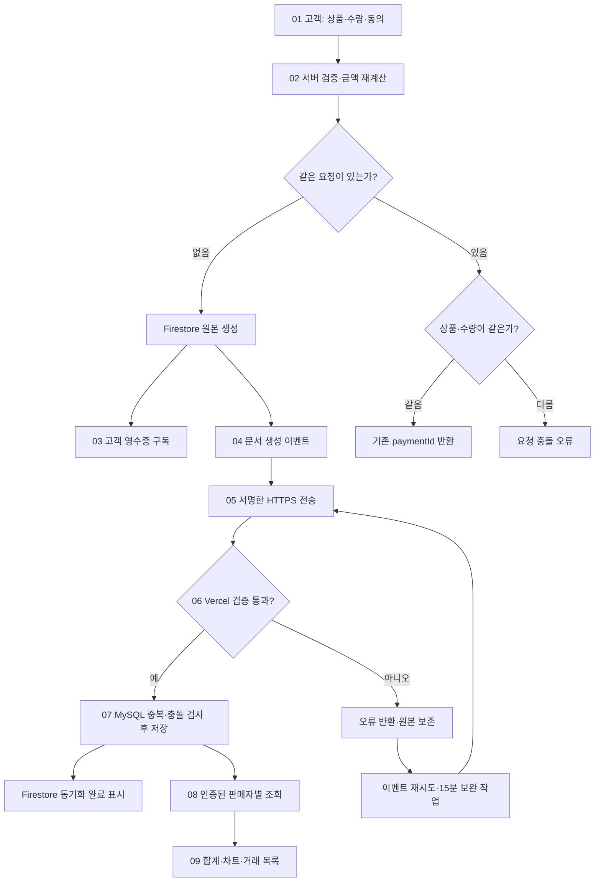
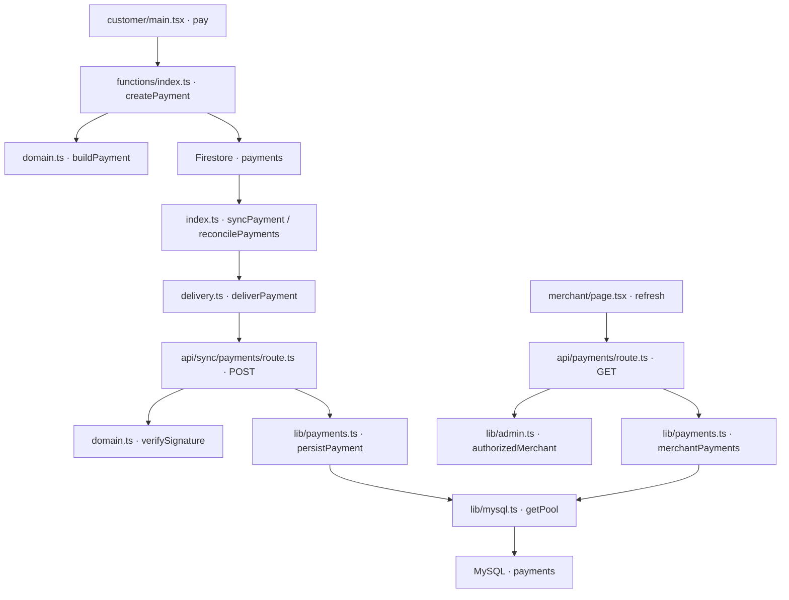

# Paybridge 구현 결과 보고서

## 구현 핵심 한 줄

하나의 모의 결제를 Firestore에 원본으로 저장하고 MySQL에 중복 없이 복제해, 고객 영수증과 판매자 매출 대시보드로 다르게 보여주도록 구현했습니다.

## 진행 과정 세 줄

1. 고객이 상품과 수량을 고르면 서버가 가격을 다시 계산해 Firestore에 저장하도록 만들었습니다.
2. 저장된 결제를 서명한 HTTPS 요청으로 Vercel에 보내고, MySQL에는 같은 결제 번호가 한 번만 저장되도록 만들었습니다.
3. 판매자 앱의 첫 배포와 무료 MySQL 생성·연결 변수 등록을 완료했으며, Firebase 배포·테이블 생성·전체 결제 시험은 계속 진행 중입니다.

## 보고서 읽는 방법

| 항목 | 내용 |
|---|---|
| 대상 | `wevolmina/paybridge-mock`의 고객·판매자 앱과 동기화 코드 |
| 목적 | 같은 거래가 두 데이터베이스와 두 화면으로 이어지는 과정 이해 |
| 클릭형 보기 | [HTML 보고서 다운로드](./IMPLEMENTATION-REPORT.html) 후 브라우저로 열기. 오른쪽 단계를 누르면 왼쪽에 설명·실제 코드·GitHub 링크 표시 |
| GitHub에서 보기 | 아래 파일 링크를 누르면 해당 함수가 있는 소스 줄로 이동 |
| 현재 배포 | [판매자 앱](https://paybridge-mock.vercel.app/) 첫 배포 완료. Firebase 로그인 설정과 결제 데이터 연결은 미완료 |

GitHub의 Markdown에서는 임의의 JavaScript가 실행되지 않으므로, 클릭형 코드 전환은 별도 HTML에서 제공합니다. 이 문서의 흐름도와 파일 링크는 GitHub에서 바로 읽을 수 있습니다.

## 구현·배포·검증 상태

| 구분 | 확인된 결과 | 아직 남은 작업 |
|---|---|---|
| 소스 | 고객·판매자·서버·테이블·시험 코드 GitHub 업로드 완료 | 변경 사항 발생 시 추가 반영 |
| Vercel | Next.js 15.5.28 첫 빌드·타입 검사·배포 성공 | Firebase·동기화 설정 후 재배포·연동 시험 |
| MySQL | Aiven 무료 MySQL 8.4 생성, TLS 인증서를 포함한 연결 변수 7개를 Vercel 비밀 값으로 등록 | 서버 준비 완료, payments 테이블 생성, 실제 연결·저장 검증 |
| Firebase | paybridge-mock 프로젝트 확인, Cloud Shell 사용 승인 완료 | 웹 앱·인증·Firestore 설정 확인, Hosting·Functions 배포 |
| 단위 검증 | 로컬 오프라인 검증에서 12개 단위 시험 및 16개 소스 구문·경로 검사 통과 | 실제 Firestore·MySQL 통합 시험 |
| 실제 결제 흐름 | 아직 성공 판정하지 않음 | 고객 입력 → 영수증 → MySQL → 판매자 표시까지 실측 |

보고서의 흐름도는 **소스에 구현된 동작**입니다. 모든 서비스에서 실행 검증까지 끝났다는 의미는 아닙니다. 실제 카드 승인이나 출금 기능은 없는 모의 결제입니다.

## 결제 처리 플로우차트

## 관련 소스 의존 관계

## 단계별 핵심 소스

| 단계 | 파일·함수로 이동 | 구현한 일 |
|---|---|---|
| 01 고객이 상품과 수량 선택 | [apps/customer/src/main.tsx](https://github.com/wevolmina/paybridge-mock/blob/main/apps/customer/src/main.tsx#L33) | 입력: 상품 ID·수량·요청 번호. 익명 로그인 후 createPayment를 호출하고 paymentId를 받습니다. 동의 체크는 처음에 꺼져 있습니다. |
| 02 서버가 금액 계산 후 원본 저장 | [functions/src/index.ts](https://github.com/wevolmina/paybridge-mock/blob/main/functions/src/index.ts#L17) | 서버 상품표로 금액을 계산하고 Firestore 트랜잭션으로 저장합니다. 같은 고객·요청 번호를 다시 보내면 기존 paymentId를 돌려줍니다. |
| 공통 검증·결제 번호·서명 규칙 | [functions/src/domain.ts](https://github.com/wevolmina/paybridge-mock/blob/main/functions/src/domain.ts#L30) | 브라우저가 보낸 금액은 받지 않습니다. 서버 상품 가격 × 수량으로 계산합니다. 고객 ID와 요청 번호로 같은 거래를 식별합니다. |
| 03 Firestore 원본으로 영수증 표시 | [apps/customer/src/main.tsx](https://github.com/wevolmina/paybridge-mock/blob/main/apps/customer/src/main.tsx#L24) | onSnapshot이 자신의 payments 문서를 구독합니다. 금액·상품·결제 번호와 동기화 상태가 영수증에 표시됩니다. |
| 04 새 문서를 감지하고 재전송 | [functions/src/index.ts](https://github.com/wevolmina/paybridge-mock/blob/main/functions/src/index.ts#L35) | 새 문서를 감지하는 syncPayment와 15분마다 미전송 문서를 확인하는 reconcilePayments가 synchronize를 호출합니다. 실패해도 원본 결제 필드를 보존합니다. |
| 05 서명과 함께 HTTPS 전송 | [functions/src/delivery.ts](https://github.com/wevolmina/paybridge-mock/blob/main/functions/src/delivery.ts#L3) | 본문·타임스탬프에 HMAC-SHA256 서명을 붙여 Vercel에 전송합니다. 최대 15초를 기다리고 HTTP 오류는 재시도 가능한 실패로 돌려줍니다. |
| 06 Vercel이 전송 내용 검증 | [apps/merchant/app/api/sync/payments/route.ts](https://github.com/wevolmina/paybridge-mock/blob/main/apps/merchant/app/api/sync/payments/route.ts#L5) | POST /api/sync/payments가 최대 16KB 본문, 서명, 5분 시간 제한, 결제 형식을 검증한 뒤 MySQL 저장 함수를 호출합니다. |
| 07 중복 없이 MySQL에 저장 | [apps/merchant/lib/payments.ts](https://github.com/wevolmina/paybridge-mock/blob/main/apps/merchant/lib/payments.ts#L7) | payment_id 기본키로 중복 행을 막고 payload_hash로 내용 충돌을 확인합니다. 같은 내용의 재전송은 성공, 다른 내용은 409 오류입니다. |
| 저장소 MySQL 결제 테이블 | [database/001-payments.sql](https://github.com/wevolmina/paybridge-mock/blob/main/database/001-payments.sql#L1) | Firestore paymentId는 MySQL payment_id에 대응합니다. merchant_created 인덱스는 판매자별 최근 거래 조회를 돕습니다. 두 DB 사이의 외래키는 없습니다. |
| 권한 판매자 신원을 서버에서 확인 | [apps/merchant/lib/admin.ts](https://github.com/wevolmina/paybridge-mock/blob/main/apps/merchant/lib/admin.ts#L13) | Firebase 인증 토큰을 서버에서 검증하고 merchant_id 권한을 읽습니다. 브라우저가 임의로 지정한 판매자 ID를 조회 조건으로 사용하지 않습니다. |
| 08 판매자별 합계·차트·거래 조회 | [apps/merchant/lib/payments.ts](https://github.com/wevolmina/paybridge-mock/blob/main/apps/merchant/lib/payments.ts#L21) | GET /api/payments는 인증된 판매자의 MySQL 데이터만 읽습니다. 전체 합계·거래 수·평균과 일별 매출, 최근 100건을 응답합니다. |
| 09 다른 UI로 매출 대시보드 표시 | [apps/merchant/app/page.tsx](https://github.com/wevolmina/paybridge-mock/blob/main/apps/merchant/app/page.tsx#L15) | 고객의 영수증과 같은 결제를 판매자 화면에서는 총매출·막대 차트·거래 목록으로 표현합니다. 로그인 후 15초마다 다시 조회합니다. |

관련 요청 창구: [GET /api/payments](https://github.com/wevolmina/paybridge-mock/blob/main/apps/merchant/app/api/payments/route.ts), 연결 설정: [getPool](https://github.com/wevolmina/paybridge-mock/blob/main/apps/merchant/lib/mysql.ts), 고객 Firebase 초기화: [firebase.ts](https://github.com/wevolmina/paybridge-mock/blob/main/apps/customer/src/firebase.ts).

## 같은 값이 두 화면에서 보이는 예시

설명용 예시입니다. 실제 운영 데이터나 시험 기록은 아닙니다.

| 값 | Firestore 원본 | MySQL 복제 | 화면 |
|---|---|---|---|
| 결제 번호 | paymentId | payment_id | 고객 영수증·판매자 거래 목록의 같은 거래 |
| 판매자 | merchantId | merchant_id | 로그인한 판매자의 조회 범위 |
| 상품·수량 | productName, quantity | product_name, quantity | 고객 주문 내역·판매자 거래 행 |
| 금액 | amount = 24,000 × 2 = 48,000원 | amount = 48000.00 | 영수증 총액·판매자 매출 합계와 차트 |
| 결제 시각 | createdAt, UTC 문자열 | created_at, UTC 날짜 | 화면에서 한국 시간으로 표시 |
| 전송 상태 | syncState = pending / synced | 행 존재와 synced_at | 영수증에서 전송 대기·완료 표시 |

Firestore와 MySQL은 외래키로 연결된 하나의 DB가 아닙니다. 같은 paymentId를 변환해 저장하며 서버 간 요청으로 내용을 전달합니다. 서버 응답이 늦거나 실패하면 잠시 양쪽의 표시 시점이 다를 수 있습니다.

## 중복·장애·권한 처리

- 중복 클릭: 고객 ID와 requestId로 같은 paymentId를 계산하고 Firestore 트랜잭션으로 기존 거래를 돌려줍니다. 동일 요청 번호의 상품·수량 변경은 거부합니다.
- 중복 이벤트: MySQL 기본키로 같은 행을 추가하지 않고, 내용 해시가 같을 때만 정상 재전송으로 인정합니다.
- 전송 실패: 원본 결제는 유지하고 오류 코드만 기록합니다. 이벤트 재시도와 15분마다 최대 100건의 대기 거래를 다시 전송하는 작업을 구현했습니다.
- 서명 검증: HMAC(Hash-based Message Authentication Code, 비밀 값을 이용한 메시지 검증 코드)-SHA256과 타임스탬프를 사용합니다. 본문이 바뀌거나 5분 시간 범위를 벗어나면 거부합니다.
- 판매자 격리: 서버가 Firebase 로그인 토큰의 merchant_id를 확인하며 합계·차트·목록의 SQL 모두에 판매자 조건을 넣습니다. 실제 두 판매자 로그인 시험은 아직 남아 있습니다.
- 연결 암호화: TLS(Transport Layer Security, 통신 암호화)를 켜고 CA(Certificate Authority, 인증서 발급 기관) 인증서로 MySQL 서버를 확인합니다.

## 검증 근거와 완료 기준

| 검증 | 결과 |
|---|---|
| 서버 가격·입력 위조·수량 범위·고정 결제 번호·충돌·서명·권한·모의 상태 등 12개 단위 시험 | 로컬 오프라인 실행 통과. 실제 외부 DB 시험과 구분 |
| Vercel 생산용 빌드 | 컴파일·타입 검사·정적 페이지 생성 통과, 첫 배포 성공 |
| MySQL 저장·중복 재전송·장애 후 복구 | 미실행 |
| Firebase 보안 규칙·다른 고객 문서 접근 차단 | 시험 코드 준비, 실제 에뮬레이터 실행 미완료 |
| 두 판매자의 데이터 분리·영수증과 매출 일치 | 미실행 |

[단위 시험 코드](https://github.com/wevolmina/paybridge-mock/blob/main/tests/domain.test.ts) · [MySQL 통합 시험 코드](https://github.com/wevolmina/paybridge-mock/blob/main/tests/integration/mysql.test.ts) · [Firestore 보안 규칙 시험 코드](https://github.com/wevolmina/paybridge-mock/blob/main/tests/integration/firestore-rules.test.ts) · [배포 절차](./DEPLOYMENT.md)

전체 완료는 모의 결제 1건을 넣어 Firestore 원본과 MySQL 행이 같은 번호·금액을 갖고, 고객 영수증과 해당 판매자 화면에 반영된 뒤 판단합니다. 중복 전송 후에도 행과 매출 합계가 늘어나지 않는지 확인해야 합니다.
